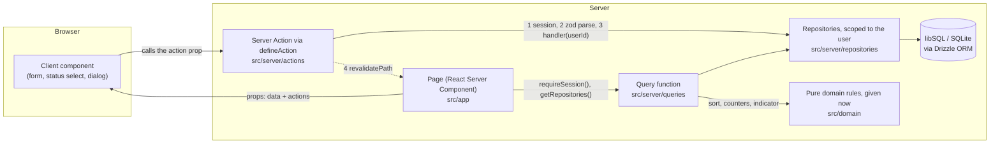

# Task Manager

[Русская версия](README.ru.md)

A task-management web app: sign in, keep several task lists, and see at a glance which need attention.
Each list card shows counters for new, in-progress, done and overdue tasks, a progress bar, and a red
(overdue) or yellow (due within 48 hours) indicator. A list opens as a sorted task table with add,
edit, delete, status change and a status filter. Each task opens as a card. There is a light, dark and
system theme. Built with Next.js (App Router), TypeScript, Tailwind CSS with shadcn/ui, and a SQLite
(libSQL) database behind a server-side data layer.

**Live demo: TBD (filled in by the owner after provisioning, see [docs/deployment/deploy-guide.md](docs/deployment/deploy-guide.md))**
— sign in with **admin@example.com** / **Admin123!**

| | Light | Dark |
| --- | --- | --- |
| Lists |  |  |
| Tasks |  |  |
| Card |  |  |

## Quick start

Requires Node.js 24 (see `.nvmrc`) and npm.

```sh
npm ci
cp .env.example .env
npm run db:migrate && npm run db:seed
npm run dev
```

Open <http://localhost:3000>, sign in with **admin@example.com** / **Admin123!**, and you land on your
lists. The data lives in `data/app.db` and survives restarts. More detail, every script, and
troubleshooting: [docs/development/development-guide.md](docs/development/development-guide.md).

## How the data layer works

The database is the only source of truth. Pages never fetch data in the browser, and no component
imports the database, the schema or seed data.



- **Reads.** A page is a React Server Component. It checks the session, gets the repositories and calls a
  query function. The query reads rows through a repository and applies the pure domain rules (sorting,
  counters, progress, the red/yellow indicator) for the current request time. The page renders the
  result as props.
- **Writes.** Client components receive Server Actions as props; they never import them. Every action is
  wrapped in `defineAction`, which checks the session, parses the input with the **same zod schema** the
  form uses, and runs the handler with the signed-in user's id. It then revalidates the affected paths so
  the next render reads fresh data. An invalid input returns field errors and never reaches the database.
- **Ownership.** Every repository call takes the user id, so a query can only see that user's rows. Another
  user's list or task id behaves exactly like a missing one (404).
- **Why no client fetching.** Server reads keep the data path in one place a reviewer can check, and keep
  every component renderable in Storybook from props alone. Browser-side code is limited to what needs
  the browser: the theme, controlled inputs, dialogs, and converting a deadline from local time.
- **Where it lives.** `src/app` (routes), `src/server/queries`, `src/server/actions`,
  `src/server/repositories` (the only code that touches Drizzle), `src/server/db` (client, schema,
  migrations runner, seed), `src/domain` (pure rules), `src/contracts` (types and zod schemas). ESLint
  enforces the boundaries on resolved file paths, so `npm run lint` fails if a component reaches the
  database.
- **Durability.** Locally the database is a SQLite file (`file:./data/app.db`). The live demo uses the same
  code against a hosted libSQL database on Turso, because a serverless host's filesystem is ephemeral.
  The app refuses a `file:` database on Vercel rather than lose writes. Schema changes are committed
  Drizzle migrations; the seed is idempotent.

Rationale and rejected alternatives: [docs/architecture/architecture.md](docs/architecture/architecture.md) and
[docs/architecture/data-layer.md](docs/architecture/data-layer.md).

## Tests

```sh
npx playwright install chromium   # once: the browser for the Storybook and e2e suites
npm test                          # unit tests (Vitest)
npm run test:storybook            # Storybook play functions + axe, in Chromium
npm run build && npm run test:e2e # Playwright end-to-end tests against the production build
npm run check:full                # all of the above + typecheck, lint, format check, build
```

| Suite | What it proves | Size (measured 2026-10-23) |
| --- | --- | --- |
| Unit (`npm test`) | Domain rules at fixed instants, incl. property-based tests; zod schemas; repositories and queries on a real temp SQLite file; auth and `defineAction`; import boundaries | 577 test cases in 50 files |
| Sorting and list counters (part of unit) | The spec's sort order and the new / in progress / done / overdue counters | 25 tests (`it` / `it.each` declarations in `sort.test.ts` and `counters.test.ts`; the spec asks for at least 8) |
| Storybook (`npm run test:storybook`) | Components as a user operates them: login submit and validation, status change, filters, dialogs, card save; axe in both themes | 156 story tests; 155 `play` functions (the spec asks for at least 5) |
| End to end (`npm run test:e2e`) | Sign-in guard, the golden path surviving a full reload, theme persistence without a flash, search and filter, modal vs. standalone card, keyboard-only use, responsive layout, axe on every page | 33 tests in 8 files |

The commands that print each number are in
[docs/testing/testing-guide.md](docs/testing/testing-guide.md#counting-the-tests); re-run them for current numbers. How to run single files, the e2e port, and screenshot regeneration:
[docs/testing/testing-guide.md](docs/testing/testing-guide.md).

## Project structure

```
src/
  app/            Routes: login, /lists, /lists/[id], /tasks/[id] (modal and standalone page)
  components/     Presentational and client components, each with stories; ui/ holds shadcn primitives
  contracts/      Shared types, constants and zod schemas (forms and Server Actions use the same ones)
  domain/         Pure rules: sorting, counters, progress, indicator, search, filter
  lib/            Framework-free helpers (deadline formatting and conversion)
  server/         Server-only: env, db, repositories, queries, actions, auth
  styles/         Design tokens and the contrast test
drizzle/          Committed SQL migrations
e2e/              Playwright specs
docs/             Requirements, decision records, guides, plans
scripts/          Repository tooling (requirement tracing, CI helpers)
```

## Design decisions

The why behind the code lives in [docs/](docs/INDEX.md). Start with:

- [Architecture](docs/architecture/architecture.md): App Router over a SPA, the layers, libSQL over JSON or in-memory
  storage, pure clock-injected domain rules, the UI kit, validation and test tooling, authentication.
- [Domain rules](docs/architecture/domain-rules.md): what "overdue" and "due soon" mean exactly, the sort order and its
  tie-breakers, counter semantics.
- [Data layer](docs/architecture/data-layer.md), [Auth](docs/architecture/auth.md), [Design system](docs/design/design-system.md),
  [Task editing and deadlines](docs/features/task-editing.md), [End-to-end test decisions](docs/testing/testing.md),
  [UX and accessibility audit](docs/design/ux-audit.md), [Deployment](docs/deployment/deployment.md).

Visual design proposals, each with light and dark screenshots (not the shipped design):
[DESIGNS.md](DESIGNS.md).

## Spec coverage

[docs/spec/requirements.md](docs/spec/requirements.md) transcribes the assignment and gives every requirement an ID
(`R-AUTH-1`, `R-SORT-2`, …). [docs/spec/traceability.md](docs/spec/traceability.md) maps each ID to the unit tests,
stories and e2e specs that prove it. It is generated by `node scripts/docs/trace-requirements.mjs`, which
fails if an AUTH, LIST, TASKS, CARD, THEME or SORT requirement has no test, story or spec naming it (the
other groups are reported, not gated).
