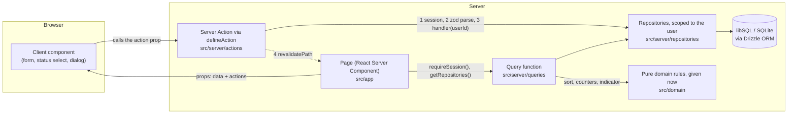

# Task Manager

[Русская версия](README.ru.md)

A task-management web app: sign in, keep several task lists, and see at a glance which need attention.
Each list card shows counters for new, in-progress, done and overdue tasks, a progress bar, and a red
(overdue) or yellow (due within 48 hours) indicator. A list opens as a sorted task table with add,
edit, delete, status change and a status filter. Each task opens as a card. There is a light, dark and
system theme. Built with Next.js (App Router), TypeScript, Tailwind CSS with shadcn/ui, and a SQLite
(libSQL) database behind a server-side data layer.

Repository: [GitHub](https://github.com/nshkuratov/task-manager).

**Live demo:** not published yet. Add the deployed application URL before submitting the assignment.

Sign in after seeding the database: **admin@example.com** / **Admin123!**.

## Quick start

Requires Node.js 24 (see `.nvmrc`) and npm.

```sh
npm ci
cp .env.example .env
npm run db:migrate && npm run db:seed
npm run dev
```

Open <http://localhost:3000> and sign in with the credentials above. Data is stored in `data/app.db` and survives restarts. In PowerShell, `Copy-Item .env.example .env` can replace `cp .env.example .env`; run migration and seed commands on separate lines if the shell does not support `&&`.

### Environment and database

All variables are documented in [.env.example](.env.example).

| Variable | Local development | Production |
| --- | --- | --- |
| `DATABASE_URL` | Defaults to `file:./data/app.db` | Vercel requires a hosted `libsql://…` URL; local files are refused |
| `DATABASE_AUTH_TOKEN` | Not needed for a file | Required for `libsql://` |
| `SESSION_SECRET` | A development-only fallback is available | Required, at least 32 characters, including local `npm run start` |

`npm run db:migrate` applies migrations from `drizzle/`; `npm run db:seed` creates the demo user and lists. Repeated seeding does not duplicate existing lists, but restores them if the demo user has no lists left. `npm run db:reset` deletes the local database and recreates it with demo data; remote databases are refused. After schema changes, `npm run db:generate` creates a migration.

For production, set `SESSION_SECRET` in `.env`, then run `npm run build` and `npm run start`. Generate a random value with:

```sh
node -e "console.log(require('node:crypto').randomBytes(48).toString('base64'))"
```

## How the data layer works

The database is the only source of truth. Pages never fetch data in the browser, and no component
imports the database, the schema or seed data.



- **Reads.** A page is a React Server Component. It checks the session, gets the repositories and calls a
  query function. The query reads rows through a repository and applies the pure domain rules (sorting,
  counters, progress, the red/yellow indicator) for the current request time. The page renders the
  result as props.
- **Writes.** Client components receive Server Actions as props; they never import them. Every action is
  wrapped in `defineAction`, which checks the session, parses the input with the **same zod schema** the
  form uses, and runs the handler with the signed-in user's id. It then revalidates the affected paths so
  the next render reads fresh data. An invalid input returns field errors and never reaches the database.
- **Ownership.** Every repository call takes the user id, so a query can only see that user's rows. Another
  user's list or task id behaves exactly like a missing one (404).
- **Why no client fetching.** Server reads keep the data path in one place a reviewer can check, and keep
  every component renderable in Storybook from props alone. Browser-side code is limited to what needs
  the browser: the theme, controlled inputs, dialogs, and converting a deadline from local time.
- **Where it lives.** `src/app` (routes), `src/server/queries`, `src/server/actions`,
  `src/server/repositories` (the only code that touches Drizzle), `src/server/db` (client, schema,
  migrations runner, seed), `src/domain` (pure rules), `src/contracts` (types and zod schemas). ESLint
  enforces the boundaries on resolved file paths, so `npm run lint` fails if a component reaches the
  database.
- **Durability.** Locally the database is a SQLite file (`file:./data/app.db`). The deployment configuration supports the same
  code against a hosted libSQL database on Turso, because a serverless host's filesystem is ephemeral.
  The app refuses a `file:` database on Vercel rather than lose writes. Schema changes are committed
  Drizzle migrations; the seed is idempotent.

## Tests

```sh
npx playwright install chromium   # once: the browser for the Storybook and e2e suites
npm test                          # unit tests (Vitest)
npm run test:storybook            # Storybook play functions + axe, in Chromium
npm run build && npm run test:e2e # Playwright end-to-end tests against the production build
npm run check:full                # all of the above + typecheck, lint, format check, build
```

Unit tests cover domain rules, zod schemas, repositories and queries on temporary SQLite databases, authentication and import boundaries. Storybook tests exercise user interactions and axe accessibility checks in both themes. E2E tests cover the full application, including persistence after a reload.

The assignment-specific tests are available directly in the repository:

- [Sorting](src/domain/sort.test.ts) and [counters](src/domain/counters.test.ts): 25 test declarations covering the required rules (the assignment requires at least 8 tests).
- [Login form](src/components/auth/login-form.stories.tsx) and [status changes](src/components/tasks/status-select.stories.tsx): more than 5 stories with `play`, including form submission, validation, loading and errors. The installed Storybook 10 imports test utilities from `storybook/test`.

```sh
npx vitest run --project unit src/domain/sort.test.ts src/domain/counters.test.ts
npm run storybook
npm run build-storybook
```

Storybook opens at <http://localhost:6006>; its static build is saved to `storybook-static/`. `test:storybook` does not require a separately running Storybook server.

E2E requires a fresh production build. Playwright starts the server on port 3210, sets a test session secret and recreates a separate `data/e2e.db` database. The port must be free. `npm run check` runs typecheck, lint, formatting checks and unit tests; `check:full` adds Storybook, build and E2E. CI is currently disabled, so run these commands locally to verify results. Test reports show current counts and pass/fail results.

## Project structure

```
src/
  app/            Routes: login, /lists, /lists/[id], /tasks/[id] (modal and standalone page)
  components/     Presentational and client components, each with stories; ui/ holds shadcn primitives
  contracts/      Shared types, constants and zod schemas (forms and Server Actions use the same ones)
  domain/         Pure rules: sorting, counters, progress, indicator, search, filter
  lib/            Framework-free helpers (deadline formatting and conversion)
  server/         Server-only: env, db, repositories, queries, actions, auth
  styles/         Design tokens and the contrast test
drizzle/          Committed SQL migrations
e2e/              Playwright specs
```

## Features and domain rules

- Login with email/password validation, pending state and error messages.
- `/lists`: create, rename, delete and search lists; each card shows status counters, progress and urgency.
- `/lists/[id]`: add, edit and delete tasks, change status and filter by status; the table shows title, status, priority and deadline.
- `/tasks/[id]`: title, description, status, priority and deadline, with saving through Server Actions. The card opens as a modal when navigating from a list, or as a standalone page via a direct URL.
- Light, dark and system themes.

Sorting is implemented in [sort.ts](src/domain/sort.ts): unfinished overdue tasks first, then other unfinished tasks, then completed tasks. Within each group, earlier deadlines come first, undated tasks come last, and equal deadlines are ordered by priority (`high`, `medium`, `low`), then title and id for deterministic ties.

A task is overdue only if it is unfinished and `deadline < now`. The yellow indicator means an unfinished task is due between `now` and `now + 48h`, inclusive; red takes precedence. Status counters sum to the total; overdue is an additional overlapping count. Progress is `done / total`, or zero for an empty list. Domain functions receive `now` explicitly, so boundary cases can be tested without depending on the system clock.

## Design choices

Next.js App Router keeps reads and writes on the server through RSC and Server Actions. Drizzle with SQLite/libSQL provides persistent storage and committed SQL migrations without a separate API service. Pure domain functions keep sorting and counters independent of React. Shared zod schemas validate input both in forms and on the server; Tailwind CSS, shadcn/ui and Radix provide the visual and interaction primitives. Components accept data and actions as props, which also lets Storybook exercise them in isolation.

## Deployment

The repository includes [vercel.json](vercel.json) for Vercel with a hosted libSQL database such as Turso. Configure `DATABASE_URL`, `DATABASE_AUTH_TOKEN` and a random `SESSION_SECRET` in the hosting project's Production environment. The configured build runs migrations, seeds the database, then builds Next.js. Non-production deployments are skipped by the configuration. Keep database credentials and local `.env` files out of Git.

The demo has not been published yet. Once it is deployed, add its public URL at the top of both README files and verify sign-in and persistence after a reload.
