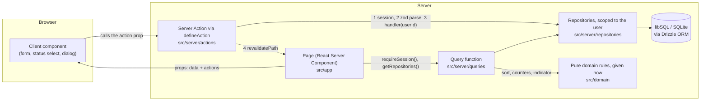

<!-- ru-source: README.md sha256:20d2cefc3c29 -->
# Task Manager

> Перевод [английского оригинала](README.md). При расхождении верен оригинал.

Веб-приложение для управления задачами: войдите, ведите несколько списков задач и сразу видите, каким из них
нужно внимание. Карточка каждого списка показывает счётчики новых, в работе, выполненных и просроченных задач,
полосу прогресса и красный (просрочка) или жёлтый (срок в ближайшие 48 часов) индикатор. Список открывается
отсортированной таблицей задач с добавлением, редактированием, удалением, сменой статуса и фильтром по статусу.
Каждая задача открывается карточкой. Есть светлая, тёмная и системная тема. Построено на Next.js (App Router),
TypeScript, Tailwind CSS с shadcn/ui и базе данных SQLite (libSQL) за серверным слоем данных.

**Демо-стенд: TBD (владелец добавит после развёртывания, см. [docs/deployment/deploy-guide.ru.md](docs/deployment/deploy-guide.ru.md))**
— вход: **admin@example.com** / **Admin123!**

| | Светлая | Тёмная |
| --- | --- | --- |
| Списки |  |  |
| Задачи |  |  |
| Карточка |  |  |

## Быстрый старт

Нужны Node.js 24 (см. `.nvmrc`) и npm.

```sh
npm ci
cp .env.example .env
npm run db:migrate && npm run db:seed
npm run dev
```

Откройте <http://localhost:3000>, войдите как **admin@example.com** / **Admin123!** — и вы попадёте на свои
списки. Данные лежат в `data/app.db` и переживают перезапуски. Подробности, все скрипты и устранение неполадок:
[docs/development/development-guide.ru.md](docs/development/development-guide.ru.md).

## Как устроен слой данных

База данных — единственный источник истины. Страницы никогда не загружают данные в браузере, и ни один
компонент не импортирует базу данных, схему или начальные данные.



- **Чтение.** Страница — это React Server Component. Она проверяет сессию, получает репозитории и вызывает
  функцию запроса. Функция запроса читает строки через репозиторий и применяет чистые доменные правила
  (сортировка, счётчики, прогресс, красный/жёлтый индикатор) для времени текущего запроса. Страница рендерит
  результат как props.
- **Запись.** Клиентские компоненты получают Server Actions через props и никогда их не импортируют. Каждое
  действие обёрнуто в `defineAction`, которое проверяет сессию, разбирает ввод **той же zod-схемой**, что и
  форма, и запускает обработчик с id вошедшего пользователя. Затем оно ревалидирует затронутые пути, чтобы
  следующий рендер прочитал свежие данные. Некорректный ввод возвращает ошибки полей и никогда не доходит до
  базы данных.
- **Владение.** Каждый вызов репозитория принимает id пользователя, поэтому запрос видит только строки этого
  пользователя. Id чужого списка или задачи ведёт себя ровно как отсутствующий (404).
- **Почему без загрузки на клиенте.** Серверное чтение держит путь данных в одном месте, которое может
  проверить ревьюер, и позволяет отрисовать любой компонент в Storybook только из props. Код в браузере
  ограничен тем, чему нужен браузер: тема, контролируемые поля ввода, диалоги и перевод срока из локального
  времени.
- **Где что лежит.** `src/app` (маршруты), `src/server/queries`, `src/server/actions`,
  `src/server/repositories` (единственный код, который обращается к Drizzle), `src/server/db` (клиент, схема,
  запуск миграций, начальные данные), `src/domain` (чистые правила), `src/contracts` (типы и zod-схемы). ESLint
  обеспечивает эти границы по разрешённым путям файлов, поэтому `npm run lint` падает, если компонент
  обращается к базе данных.
- **Надёжность хранения.** Локально база данных — файл SQLite (`file:./data/app.db`). Демо-стенд использует тот
  же код с размещённой базой данных libSQL на Turso, потому что файловая система serverless-хостинга
  эфемерна. Приложение отказывается работать с базой `file:` на Vercel, чтобы не терять записи. Изменения схемы —
  закоммиченные миграции Drizzle; начальные данные идемпотентны.

Обоснование и отвергнутые альтернативы: [docs/architecture/architecture.ru.md](docs/architecture/architecture.ru.md) и
[docs/architecture/data-layer.ru.md](docs/architecture/data-layer.ru.md).

## Тесты

```sh
npx playwright install chromium   # once: the browser for the Storybook and e2e suites
npm test                          # unit tests (Vitest)
npm run test:storybook            # Storybook play functions + axe, in Chromium
npm run build && npm run test:e2e # Playwright end-to-end tests against the production build
npm run check:full                # all of the above + typecheck, lint, format check, build
```

| Набор | Что доказывает | Размер (измерен 2026-10-23) |
| --- | --- | --- |
| Модульные (`npm test`) | Доменные правила в фиксированные моменты времени, включая property-based тесты; zod-схемы; репозитории и функции запроса на настоящем временном файле SQLite; аутентификация и `defineAction`; границы импорта | 577 тест-кейсов в 50 файлах |
| Сортировка и счётчики списков (часть модульных) | Порядок сортировки из спецификации и счётчики новых / в работе / выполненных / просроченных | 25 тестов (объявления `it` / `it.each` в `sort.test.ts` и `counters.test.ts`; спецификация требует не менее 8) |
| Storybook (`npm run test:storybook`) | Компоненты так, как с ними работает пользователь: отправка формы входа и валидация, смена статуса, фильтры, диалоги, сохранение карточки; axe в обеих темах | 156 тестов стори; 155 `play`-функций (спецификация требует не менее 5) |
| End-to-end (`npm run test:e2e`) | Защита маршрутов входом, основной сценарий, переживающий полную перезагрузку страницы, сохранение темы без мигания, поиск и фильтр, карточка в модальном окне и на отдельной странице, работа только с клавиатуры, адаптивная вёрстка, axe на каждой странице | 33 теста в 8 файлах |

Команды, печатающие каждое число, — в
[docs/testing/testing-guide.ru.md](docs/testing/testing-guide.ru.md#подсчёт-тестов); перезапустите их, чтобы получить текущие значения. Как запускать отдельные файлы, порт e2e и перегенерация скриншотов:
[docs/testing/testing-guide.ru.md](docs/testing/testing-guide.ru.md).

## Структура проекта

```
src/
  app/            Routes: login, /lists, /lists/[id], /tasks/[id] (modal and standalone page)
  components/     Presentational and client components, each with stories; ui/ holds shadcn primitives
  contracts/      Shared types, constants and zod schemas (forms and Server Actions use the same ones)
  domain/         Pure rules: sorting, counters, progress, indicator, search, filter
  lib/            Framework-free helpers (deadline formatting and conversion)
  server/         Server-only: env, db, repositories, queries, actions, auth
  styles/         Design tokens and the contrast test
drizzle/          Committed SQL migrations
e2e/              Playwright specs
docs/             Requirements, decision records, guides, plans
scripts/          Repository tooling (requirement tracing, CI helpers)
```

## Проектные решения

Обоснования решений, стоящих за кодом, собраны в [docs/](docs/INDEX.ru.md). Начните с:

- [Архитектура](docs/architecture/architecture.ru.md): App Router вместо SPA, слои, libSQL вместо JSON или хранения в памяти,
  чистые доменные правила с внедрённым временем, UI-кит, инструменты валидации и тестирования, аутентификация.
- [Доменные правила](docs/architecture/domain-rules.ru.md): что именно означают «просрочка» и «срок в ближайшие 48 часов»,
  порядок сортировки и его правила разрешения равенства, семантика счётчиков.
- [Слой данных](docs/architecture/data-layer.ru.md), [Аутентификация](docs/architecture/auth.ru.md), [Дизайн-система](docs/design/design-system.ru.md),
  [Редактирование задач и сроки](docs/features/task-editing.ru.md), [Решения по end-to-end тестам](docs/testing/testing.ru.md),
  [Аудит UX и доступности](docs/design/ux-audit.ru.md), [Развёртывание](docs/deployment/deployment.ru.md).

Предложения по визуальному дизайну со скриншотами в светлой и тёмной темах (не текущий дизайн):
[DESIGNS.md](DESIGNS.md).

## Покрытие спецификации

[docs/spec/requirements.ru.md](docs/spec/requirements.ru.md) транскрибирует задание и присваивает каждому требованию ID
(`R-AUTH-1`, `R-SORT-2`, …). [docs/spec/traceability.md](docs/spec/traceability.md) сопоставляет каждый ID с модульными
тестами, стори и e2e-спецификациями, которые его доказывают. Он генерируется командой
`node scripts/docs/trace-requirements.mjs`, которая падает, если у требования AUTH, LIST, TASKS, CARD, THEME или
SORT нет называющих его теста, стори или спецификации (остальные группы выводятся в отчёт, но не блокируют).
