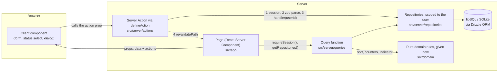

<!-- ru-source: README.md sha256:cfa7cb37fc7a -->
# Task Manager

> Перевод [английского оригинала](README.md). При расхождении верен оригинал.

Веб-приложение для управления задачами: войдите, ведите несколько списков задач и сразу видите, каким из них
нужно внимание. Карточка каждого списка показывает счётчики новых, в работе, выполненных и просроченных задач,
полосу прогресса и красный (просрочка) или жёлтый (срок в ближайшие 48 часов) индикатор. Список открывается
отсортированной таблицей задач с добавлением, редактированием, удалением, сменой статуса и фильтром по статусу.
Каждая задача открывается карточкой. Есть светлая, тёмная и системная тема. Построено на Next.js (App Router),
TypeScript, Tailwind CSS с shadcn/ui и базе данных SQLite (libSQL) за серверным слоем данных.

Репозиторий: [GitHub](https://github.com/nshkuratov/task-manager).

**Демо-стенд:** ещё не опубликован. Перед сдачей по ТЗ необходимо добавить адрес опубликованного приложения.

Вход после заполнения базы: **admin@example.com** / **Admin123!**.

## Быстрый старт

Нужны Node.js 24 (см. `.nvmrc`) и npm.

```sh
npm ci
cp .env.example .env
npm run db:migrate && npm run db:seed
npm run dev
```

Откройте <http://localhost:3000> и войдите с учётными данными выше. Данные хранятся в `data/app.db` и переживают перезапуски. В PowerShell вместо `cp .env.example .env` можно использовать `Copy-Item .env.example .env`; команды миграции и заполнения базы запускайте отдельными строками, если оболочка не поддерживает `&&`.

### Окружение и база данных

Все переменные описаны в [.env.example](.env.example).

| Переменная | Локальная разработка | Production |
| --- | --- | --- |
| `DATABASE_URL` | По умолчанию `file:./data/app.db` | На Vercel нужен адрес `libsql://…`; локальные файлы запрещены |
| `DATABASE_AUTH_TOKEN` | Не нужен для файла | Обязателен для `libsql://` |
| `SESSION_SECRET` | Есть значение только для разработки | Обязателен, минимум 32 символа, в том числе для локального `npm run start` |

`npm run db:migrate` применяет миграции из `drizzle/`; `npm run db:seed` создаёт тестового пользователя и списки. Повторный seed не дублирует существующие списки, но восстанавливает их, если у тестового пользователя не осталось списков. `npm run db:reset` удаляет локальную базу и создаёт её заново с тестовыми данными; удалённые базы не поддерживаются. После изменения схемы `npm run db:generate` создаёт новую миграцию.

Для production задайте `SESSION_SECRET` в `.env`, затем выполните `npm run build` и `npm run start`. Случайное значение можно сгенерировать командой:

```sh
node -e "console.log(require('node:crypto').randomBytes(48).toString('base64'))"
```

## Как устроен слой данных

База данных — единственный источник истины. Страницы никогда не загружают данные в браузере, и ни один
компонент не импортирует базу данных, схему или начальные данные.



- **Чтение.** Страница — это React Server Component. Она проверяет сессию, получает репозитории и вызывает
  функцию запроса. Функция запроса читает строки через репозиторий и применяет чистые доменные правила
  (сортировка, счётчики, прогресс, красный/жёлтый индикатор) для времени текущего запроса. Страница рендерит
  результат как props.
- **Запись.** Клиентские компоненты получают Server Actions через props и никогда их не импортируют. Каждое
  действие обёрнуто в `defineAction`, которое проверяет сессию, разбирает ввод **той же zod-схемой**, что и
  форма, и запускает обработчик с id вошедшего пользователя. Затем оно ревалидирует затронутые пути, чтобы
  следующий рендер прочитал свежие данные. Некорректный ввод возвращает ошибки полей и никогда не доходит до
  базы данных.
- **Владение.** Каждый вызов репозитория принимает id пользователя, поэтому запрос видит только строки этого
  пользователя. Id чужого списка или задачи ведёт себя ровно как отсутствующий (404).
- **Почему без загрузки на клиенте.** Серверное чтение держит путь данных в одном месте, которое может
  проверить ревьюер, и позволяет отрисовать любой компонент в Storybook только из props. Код в браузере
  ограничен тем, чему нужен браузер: тема, контролируемые поля ввода, диалоги и перевод срока из локального
  времени.
- **Где что лежит.** `src/app` (маршруты), `src/server/queries`, `src/server/actions`,
  `src/server/repositories` (единственный код, который обращается к Drizzle), `src/server/db` (клиент, схема,
  запуск миграций, начальные данные), `src/domain` (чистые правила), `src/contracts` (типы и zod-схемы). ESLint
  обеспечивает эти границы по разрешённым путям файлов, поэтому `npm run lint` падает, если компонент
  обращается к базе данных.
- **Надёжность хранения.** Локально база данных — файл SQLite (`file:./data/app.db`). Для демо предусмотрен тот
  же код с размещённой базой данных libSQL на Turso, потому что файловая система serverless-хостинга
  эфемерна. Приложение отказывается работать с базой `file:` на Vercel, чтобы не терять записи. Изменения схемы —
  закоммиченные миграции Drizzle; начальные данные идемпотентны.

## Тесты

```sh
npx playwright install chromium   # once: the browser for the Storybook and e2e suites
npm test                          # unit tests (Vitest)
npm run test:storybook            # Storybook play functions + axe, in Chromium
npm run build && npm run test:e2e # Playwright end-to-end tests against the production build
npm run check:full                # all of the above + typecheck, lint, format check, build
```

Модульные тесты проверяют доменные правила, zod-схемы, репозитории и запросы на временной SQLite-базе, авторизацию и границы импортов. Storybook проверяет действия пользователя и доступность через axe в обеих темах. E2E проверяет приложение целиком, включая сохранение после перезагрузки.

Требуемые ТЗ тесты доступны прямо в репозитории:

- [Сортировка](src/domain/sort.test.ts) и [счётчики](src/domain/counters.test.ts): 25 объявлений тестов, покрывающих требуемые правила (минимум по ТЗ — 8 тестов).
- [Форма входа](src/components/auth/login-form.stories.tsx) и [смена статуса](src/components/tasks/status-select.stories.tsx): более 5 историй с `play`, включая отправку формы, валидацию, загрузку и ошибки. В установленном Storybook 10 тестовые утилиты импортируются из `storybook/test`.

```sh
npx vitest run --project unit src/domain/sort.test.ts src/domain/counters.test.ts
npm run storybook
npm run build-storybook
```

Storybook открывается на <http://localhost:6006>; статическая сборка сохраняется в `storybook-static/`. Для `test:storybook` отдельно запускать сервер Storybook не нужно.

E2E требует свежую production-сборку. Playwright сам запускает сервер на порту 3210, задаёт тестовый секрет и пересоздаёт отдельную базу `data/e2e.db`. Порт должен быть свободен. `npm run check` запускает typecheck, lint, проверку форматирования и модульные тесты; `check:full` добавляет Storybook, сборку и E2E. CI сейчас отключён, поэтому результат проверяется локальным запуском команд. Актуальные количества и результаты тестов выводятся в отчётах запуска.

## Структура проекта

```
src/
  app/            Routes: login, /lists, /lists/[id], /tasks/[id] (modal and standalone page)
  components/     Presentational and client components, each with stories; ui/ holds shadcn primitives
  contracts/      Shared types, constants and zod schemas (forms and Server Actions use the same ones)
  domain/         Pure rules: sorting, counters, progress, indicator, search, filter
  lib/            Framework-free helpers (deadline formatting and conversion)
  server/         Server-only: env, db, repositories, queries, actions, auth
  styles/         Design tokens and the contrast test
drizzle/          Committed SQL migrations
e2e/              Playwright specs
```

## Функции и доменные правила

- Вход с валидацией email и пароля, состоянием загрузки и сообщениями об ошибках.
- `/lists`: создание, переименование, удаление и поиск списков; карточки показывают счётчики статусов, прогресс и срочность.
- `/lists/[id]`: добавление, редактирование и удаление задач, смена статуса и фильтр по статусу; таблица показывает название, статус, приоритет и дедлайн.
- `/tasks/[id]`: название, описание, статус, приоритет и дедлайн с сохранением через Server Actions. При переходе из списка карточка открывается в модальном окне, по прямому URL — отдельной страницей.
- Светлая, тёмная и системная темы.

Сортировка реализована в [sort.ts](src/domain/sort.ts): сначала незавершённые просроченные задачи, затем остальные незавершённые, затем выполненные. Внутри каждой группы раньше идут ближайшие дедлайны, задачи без срока — в конце; при одинаковом сроке порядок определяется приоритетом (`high`, `medium`, `low`), затем названием и id для однозначного разрешения совпадений.

Задача просрочена, только если она не завершена и `deadline < now`. Жёлтый индикатор означает незавершённую задачу со сроком от `now` до `now + 48h` включительно; красный имеет приоритет. Сумма счётчиков статусов равна общему числу задач; просроченные считаются дополнительно и пересекаются со статусами. Прогресс равен `done / total`, для пустого списка — нулю. Доменные функции явно получают `now`, поэтому граничные случаи тестируются независимо от системного времени.

## Проектные решения

Next.js App Router выполняет чтение и запись на сервере через RSC и Server Actions. Drizzle с SQLite/libSQL обеспечивает постоянное хранение и SQL-миграции в репозитории без отдельного API-сервиса. Чистые доменные функции отделяют сортировку и счётчики от React. Общие zod-схемы проверяют ввод в формах и на сервере; Tailwind CSS, shadcn/ui и Radix предоставляют визуальные и интерактивные примитивы. Компоненты получают данные и действия через props, что позволяет проверять их изолированно в Storybook.

## Развёртывание

В репозитории есть [vercel.json](vercel.json) для Vercel с размещённой базой libSQL, например Turso. В окружении Production проекта хостинга задайте `DATABASE_URL`, `DATABASE_AUTH_TOKEN` и случайный `SESSION_SECRET`. Настроенная команда сборки применяет миграции, заполняет базу и собирает Next.js. Конфигурация пропускает развёртывания вне production. Учётные данные базы и локальные файлы `.env` не должны попадать в Git.

Демо ещё не опубликовано. После развёртывания добавьте публичный URL в начало обоих README и проверьте вход и сохранение данных после перезагрузки страницы.
